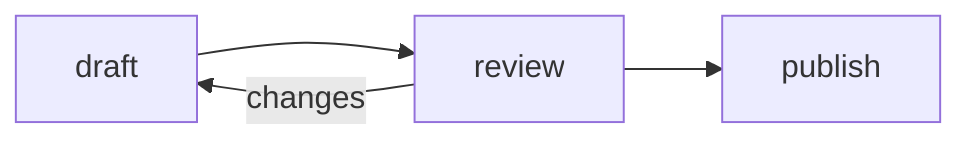

# reader

A local, two-pane reader and editor for a directory of markdown. Pick a file:
it's rendered on the left and editable on the right, and the left side follows
you as you type.

```console
$ reader ~/Documents/self/therapy/journal
```

Opens <http://127.0.0.1:8734/>. `Ctrl-C` stops it. Nothing leaves your machine.

Run it again on another directory and that one gets the next free port
(8735, 8736, …), so each directory has its own tab. `--port` asks for one port
exactly.

## Asides

A line starting `~` is an **aside**: your own voice, set in a column of
its own beside the text, level with the line you were reacting to. It
doesn't change the shape of what it's written in: a list stays one list
with an aside between its items.

```markdown
I continue to mourn things that I loved being in the stream of.

~ Maybe a post about the music; go towards the music
```

An aside can also say **who** it's from and **what** it's about, for
reviewing a document in its margin. Declare one-character aliases in the
front matter, then put them straight after the `~`, in any order:

```markdown
-----
reviewer #: Josh
reviewer m: Maria, teal
topic c: Coherence
topic s: Style
-----

Some paragraph.

~#c This contradicts §2.
~ms Too long; split it.
```

The aside then opens with the reviewer's name, in their colour, and a pill
for each topic, and its rule takes the reviewer's colour. A legend under
the byline lists who and what with how many asides each. A colour after a
name is that alias's own; the rest come from a palette that holds up in
print. A run of aliases with one that isn't declared still makes an aside,
with that one marked `?` for a slip of the finger. With more than one, or
in a document with no aliases, a `~word` line reads as text, as it always
has. In a deck, the aliases go in the deck's front matter.

Emoji shortcodes like `:tada:` show as 🎉 in the rendered pane but stay as
`:tada:` in the file. Code spans and unknown names are left as written.

`scripture:` makes a link to Blue Letter Bible, in the RSV unless a version
follows a comma:

| You write | Links to | Shows |
| --- | --- | --- |
| `scripture:[Isaiah 2:1-5]` | `blueletterbible.org/rsv/isaiah/2/1-5` | Isaiah 2:1-5 |
| `scripture:[Isaiah 2:1-5, NIV]` | `blueletterbible.org/niv/isaiah/2/1-5` | Isaiah 2:1-5, NIV |
| `scripture:isaiah/2/1-5[plowshares]` | `blueletterbible.org/rsv/isaiah/2/1-5` | plowshares |

As with emoji, the file keeps what you typed. References in code, and bracketed
text that doesn't read as `Book ch[:vs]`, are left as written.

`scripture-lds:` does the same for any of the standard works -- Bible, Book
of Mormon, Doctrine and Covenants, Pearl of Great Price -- on
churchofjesuschrist.org. Books go by their full names or the usual short ones
(`1 Ne`, `D&C`, `JS—H`, `A of F`):

| You write | Links to | Shows |
| --- | --- | --- |
| `scripture-lds:[D&C 88:26]` | `…/dc-testament/dc/88?lang=eng&id=p26#p26` | D&C 88:26 |
| `scripture-lds:[1 Nephi 3:7]` | `…/bofm/1-ne/3?lang=eng&id=p7#p7` | 1 Nephi 3:7 |
| `scripture-lds:[Articles of Faith 13]` | `…/pgp/a-of-f/1?lang=eng&id=p13#p13` | Articles of Faith 13 |
| `scripture-lds:dc/88/26[quickened]` | `…/dc-testament/dc/88?lang=eng&id=p26#p26` | quickened |

`rfc:` does the same for the RFC Editor. The brackets are required; left empty,
they read as the RFC's name:

| You write | Links to | Shows |
| --- | --- | --- |
| `rfc:9110[]` | `rfc-editor.org/rfc/rfc9110.html` | RFC 9110 |
| `rfc:9110#section-15.5[]` | `rfc-editor.org/rfc/rfc9110.html#section-15.5` | RFC 9110 §15.5 |
| `rfc:6749[OAuth 2.0]` | `rfc-editor.org/rfc/rfc6749.html` | OAuth 2.0 |

`search:` makes a Google search, for something to look into later. It shows
with a dotted underline and a ⌕. Spaces in the bracket become `+` in the
query, so these two are the same search:

| You write | Searches for | Shows |
| --- | --- | --- |
| `search:[commensality]` | commensality | commensality |
| `search:[My Many Worded Term]` | My+Many+Worded+Term | My Many Worded Term |
| `search:my+many+worded+term[My Many Worded Term]` | my+many+worded+term | My Many Worded Term |

`linkedin:`, `bluesky:`, `gh:`, `fb:`, `insta:` and `yt:` say where to
find someone: a link to that profile, with the site's mark before it. Words
in the brackets are shown instead of the address.

| You write | Links to | Shows |
| --- | --- | --- |
| `linkedin:jzheaux[]` | `linkedin.com/in/jzheaux` | linkedin.com/in/jzheaux |
| `linkedin:company/vmware[]` | `linkedin.com/company/vmware` | linkedin.com/company/vmware |
| `bluesky:jzheaux[]` | `bsky.app/profile/jzheaux.bsky.social` | @jzheaux.bsky.social |
| `bluesky:jzheaux.dev[]` | `bsky.app/profile/jzheaux.dev` | @jzheaux.dev |
| `gh:jzheaux[]` | `github.com/jzheaux` | github.com/jzheaux |
| `fb:jzheaux[]` | `facebook.com/jzheaux` | facebook.com/jzheaux |
| `insta:jzheaux[]` | `instagram.com/jzheaux` | @jzheaux |
| `yt:jzheaux[]` | `youtube.com/@jzheaux` | @jzheaux |
| `gh:jzheaux[my GitHub]` | `github.com/jzheaux` | my GitHub |

`date:` is a day, written year-month-day and read in words. Words in the
brackets are shown instead, and with no day at all it is a blank to pick one
into:

| You write | Shows |
| --- | --- |
| `date:2026-11-10[]` | November 10, 2026 |
| `date:2026-11-10[the deadline]` | the deadline |
| `date:[]` | *pick a date* |

Hover a date and a calendar shows its month, the day marked. Click the date
(or press `Enter` on it) and the calendar stays open: `‹` and `›` go from
month to month, and clicking a day writes it into the file in the date's
place, saved like typing. The arrow keys move by a day or a week, `PageUp`
and `PageDown` by a month, `Enter` picks, and `Esc` or a click elsewhere
closes it. This works in work mode too, though not on a slide. A date that
isn't one (`date:2026-02-30[]`) stays as typed.

`->`, `<-` and `<->` show as →, ← and ↔. A backslash (`\->`) keeps them as
typed.

`math:[…]` sets relations between ideas as symbols, keeping the words
upright. Alone on its line it is centered like an equation; within a sentence
it stays inline:

| You write | Shows |
| --- | --- |
| `>=` `<=` `!=` `~=` | ≥ ≤ ≠ ≈ |
| `>>` `<<` | ≫ ≪ |
| `->` `<-` `<->` | → ← ↔ |
| `*` `+-` `-` | × ± − |
| `.:` `inf` | ∴ ∞ |

```markdown
math:[recognition >> judgment]
```

A `-` joining two words (`self-worth`) stays a hyphen.

`Q:` and `A:` at the start of a line make an exchange, set apart from the
notes around it: the question in italics, the answer upright. A name in
parentheses shows beside the label. Another `A:` straight after an answer --
unnamed, or naming the same person -- continues it as a new paragraph, and the
same goes for `Q:`:

```markdown
Q (audience): Is this a pendulum swing or an integration?
A (Thomas): An integration.

A: The renaissance and the scientific revolution each had half of it.
A (Sarah): I'd say it's a spiral.
```

That is one answer from Thomas in two paragraphs, then one from Sarah. Any
line starting at the margin that isn't `Q:` or `A:` ends the exchange.

A backslash (`\A:`) keeps a line that happens to start that way as typed.

A line starting `@ ` is a **form field**: a label, a colon, and whatever's
filled in after it, which can be nothing yet.

```markdown
@ My Name: Josh
@ Date:
```

shows as

> **My Name:** Josh<br>
> **Date:** \_\_\_\_\_\_\_\_

with the value on a ruled blank. Each colon is a line of blank, so a longer
answer gets more room, running to the end of the line:

```markdown
@ Notes:::
```

shows as

> **Notes:** \_\_\_\_\_\_\_\_\_\_\_\_\_\_\_\_<br>
> &emsp;&emsp;&emsp;&ensp;\_\_\_\_\_\_\_\_\_\_\_\_\_\_\_\_<br>
> &emsp;&emsp;&emsp;&ensp;\_\_\_\_\_\_\_\_\_\_\_\_\_\_\_\_

The value still goes on the one line in the file, wrapping only on the page,
and a blank grows if it outruns its lines. Click the label, the blank, or
beside them to fill it in, right on the page: `Enter` (or clicking away)
writes it into the file, saved like typing; `Esc` puts it back; `Tab` and `⇧Tab` write it and
move to the next field or the one before. As with puzzles, this works in work
mode too. The value is shown just as typed, with no markdown.

A blockquote whose last line starts with `--` takes that line as its
attribution, set right-aligned under the quote. Links, and `scripture:`, work
there as anywhere:

```markdown
> The road of excess leads to the palace of wisdom.
> -- [William Blake](https://en.wikipedia.org/wiki/The_Marriage_of_Heaven_and_Hell)
```

Text can be colored and set in another font by naming the styles in braces
after it: `[this is red]{red}`, `[both]{darkgreen times-new-roman}`. A CSS
color name (`red`, `slategray`, `rebeccapurple`, ...) sets the color; any
other name is a font, with hyphens for spaces. A font you don't have falls
back to the page's own. For whole paragraphs, lists or tables, fence them with
`:::`:

```markdown
::: slategray georgia
Everything here is gray and in Georgia,

- lists and tables included,

until the closing line.
:::
```

A `:::` block named `columns` sets what's in it **side by side**, each
block a column, all the same width:

````markdown
::: columns
```number
15%
daily code change
```

```number
26%
weekly code change
```
:::
````

- Any block can be a column: a paragraph, a list, an image, a quote, a
  fence.
- For a column of more than one block, put a `+++` line between the
  columns. Then only those lines start one:

  ```markdown
  ::: columns
  ### Before
  * slow
  * manual
  +++
  ### After
  * fast
  * automatic
  :::
  ```
- The other names on the line are styles for everything in it, as on any
  `:::` block: `::: columns slategray avenir-next`.
- Blocks nest: a style block in a column, or columns in a column.
- An aside written in a columns block, or right after it, sits beside all
  of it.

A few GitHub conventions show as they do there:

- **Callouts.** A blockquote that opens with `[!NOTE]`, `[!TIP]`,
  `[!IMPORTANT]`, `[!WARNING]` or `[!CAUTION]` becomes a box headed with 📝 💡
  ❗ ⚠️ or 🛑.

  ```markdown
  > [!WARNING]
  > my information
  ```

- **Tasks.** `- [ ] take out the trash` shows a checkbox, and `- [x]` a
  checked one. Clicking a box rewrites the `[ ]` in the file, as an ordinary
  (undoable) edit. `- ( )` and `- (x)` are radio buttons instead: only one in
  a list can be chosen, and choosing one clears the others' `(x)`. A heading
  takes a checkbox too, `## [ ] Stretch`, to mark what's under it done;
  `## \[ ] Stretch` keeps the brackets as typed.

- **Tables.** Pipe tables, with `:---:` and `---:` for alignment.

- **Figures.** An image alone in its paragraph gets a caption: its title if it
  has one, otherwise its alt text. `` is
  captioned "Ginger, 2019".

- **Puzzles.** A fence named for a puzzle is drawn as the puzzle and can be
  played right on the page, in edit, work and present modes alike. The
  fence's text *is* the puzzle and the progress made on it: each move is
  written back into the file, saved like typing, so it's there next time and
  reads as plain text anywhere else. Click a puzzle (or Tab to it) to play;
  while it has focus it takes the keys, and `Esc` hands them back. `?` shows
  them. There are five so far: `sudoku`, `tracks`, `wordsearch`, `coord` and `maze`. A puzzle can sit in a quote or a list too.

  **Sudoku:**

  ~~~markdown
  ```sudoku
  5 3 . | . 7 . | . . .    5 3 4 | . 7 . | . . .
  6 . . | 1 9 5 | . . .    6 . . | 1 9 5 | . . .
  ------+-------+------    ------+-------+------
  ...
  notes: r1c4=26 r2c2=47
  ```
  ~~~

  Each row is the puzzle as given, then the board as played; givens can't be
  overwritten. Only digits and dots count, so the bars and rules are just for
  the eye, and a fresh puzzle can leave the board out. `notes:` holds pencil
  marks by row and column. A number repeated in a row, column or box shows
  red; a full board with none says so.

  | | |
  | --- | --- |
  | `←` `→` `↑` `↓` | move |
  | `1`–`9` | fill in a number (again to erase it) |
  | `⇧1`–`⇧9` | pencil mark |
  | `n` | pencil marks on / off |
  | `⌫` `0` | erase |

  **Train tracks:** one track from A to B, never branching or crossing
  itself; the numbers say how many squares in each column and row it runs
  through.

  ~~~markdown
  ```tracks
  2 2 8 8 8 6 5 0
  · · · · · · ┓ ·  5
  ┓ ─ ┐ ┗ · · · ·  7
  · · ╵ × · · · ·  6
  ...
  A: left 2  B: bottom 5
  ```
  ~~~

  The first line is the column counts, then each row of squares with its
  count, then the edge (`left`, `right`, `top`, `bottom`) and row or column
  where the track comes in and goes out. A square shows its track: heavy
  pieces (`━ ┃ ┏ ┓ ┗ ┛`) were given, light ones (`─ │ ┌ ┐ └ ┘`) were laid, a
  half piece (`╴ ╵ ╶ ╷`) is track laid in but not yet out, `×` is a square
  marked as having none, and `·` is undecided. A count turns green when its
  row or column has that many squares of track, red when it has more; a
  finished track says so.

  | | |
  | --- | --- |
  | `←` `→` `↑` `↓` | move |
  | `⇧` + arrow, or drag | lay track that way; again (or drag back) to pick it up |
  | `x`, or double-click | mark a square with no track |
  | `⌫` | clear a square |

  **Word search:**

  ~~~markdown
  ```wordsearch
  E B E L I E V E X
  H O N E S T Q R P
  ...
  words: ABLE, BELIEVE, HOLY GHOST, HONEST
  found: BELIEVE r1c2-r1c8, HONEST r2c1-r2c6
  marks: NEST r2c3-r2c6
  ```
  ~~~

  The letters a row to a line (the spaces between them are for the eye), the
  words to find, and those found so far, each with the row and column of its
  first and last letters. A word runs in a straight line in any of the eight
  directions; a space in a word isn't in the grid. A listed word, circled,
  is ringed in color and crossed off the list. Anything else circled -- a
  word that isn't listed, or the start of one that is -- stays ringed in
  gray under `marks:`, and goes when circled again, or when a listed word is
  found over it.

  | | |
  | --- | --- |
  | `←` `→` `↑` `↓` | move |
  | `Space` or `Enter` | start a word; again at its last letter to circle it |
  | drag, or click both ends | circle a word |
  | `⌫` | erase gray marks through this letter |
  | `Esc` | let go of a word |

  **Coordinate graph:** a mystery picture, drawn point by point.

  ~~~markdown
  ```coord
  grid: 20 x 24
  (3, 1) (17, 1) (17, 9) (3, 9) (3, 1)
  (2, 9) (18, 9) (17, 10) (3, 10) (2, 9)
  ...
  plotted: 7
  ```
  ~~~

  The grid's width and height, then the points, one pencil stroke to a line
  (START to STOP, as the list beside the graph shows them), then how many
  have been plotted, counting through the lines in order. Points are plotted
  in order: the pencil goes where it's moved, and the next point is drawn
  in, joined to the one before it, only if that's where it is. The axis
  numbers under the pencil light up, but finding the point is up to you.

  | | |
  | --- | --- |
  | `←` `→` `↑` `↓` | move the pencil; with `⇧`, five at a time |
  | `Space` or `Enter`, or click | plot the next point there |
  | `⌫` | take back the last point |

A code fence is highlighted for its language (`c`, `bash`, `asciidoc`,
`js`, and the rest highlight.js knows); a fence in a language it doesn't
know, or none, is left plain. Braces after the language pick out lines,
counted from 1 inside the fence: `{3,5-7}` makes them stand out and the
rest fade, and `{numbers}` numbers every line. Ranges separated by `|`
take turns: on a slide, the first stands out when the fence appears, and
each `n` moves on to the next.

````markdown
```c {numbers 2|4-5}
#include <stdio.h>
int main(void) {
  printf("hi\n");
  return 0;
}
```
````

A `mermaid` fence is drawn as a [Mermaid](https://mermaid.js.org/) diagram:
a flowchart, a sequence, a state machine, a timeline and so on. While you
type, the diagram keeps its last good drawing until the text reads again,
and says under it what's wrong. In a file opened anywhere else, the fence
is still its source.

````markdown

````

A `headline` fence is set like a clipping from the paper it ran in: the
paper's name, the headline, and who wrote it and when.

````markdown
```headline
Sam Altman Says "Code Is Free," Then Hires 400 Engineers

The company says the two facts are unrelated.
agency: The New York Times
by: A. Reporter
date: October 3, 2026
url: https://www.nytimes.com/2026/10/03/the-story.html
```
````

- The text is the headline, as you'd write it, quotes, commas and all. A
  second paragraph is the line under it.
- `agency:`, `by:`, `date:` and `url:` lines, anywhere in the fence, say
  the rest; all are optional. The headline links to the `url`.
- The New York Times, The Atlantic, The Guardian, WIRED and Slashdot are
  each set in something like their own type and colors, from fonts your
  machine has (for the Times's nameplate, install
  [Chomsky](https://github.com/ctrlcctrlv/chomsky)). A paper is known by its `agency:` or, without one, by where
  the `url:` points. Any other paper gets a plain clipping.
- Alone on a slide under its title, a headline is centered.

A `number` fence is a figure worth a box of its own: the number, big, and
a line under it saying what it counts.

````markdown
```number
15%
daily code change
```
````

- The first line is the number; the rest is the line under it, which is
  optional. Both are prose, so `[15%]{seagreen}` colors the number.
- A long number is set smaller, to stay on one line in its box.
- Alone on a slide under its title, a number is centered. For several in a
  row, put them in a `::: columns` block; the boxes come out the same size.

An image's size goes after its address as `=WxH`, in pixels, as in the
markdown-it-imsize convention. Leave one side out to keep the image's
proportions: `=100x` sets only the width, `=x200` only the height. A title
still goes before it.

```markdown


```

Everything else is ordinary markdown. Front matter (`Title`, `Author`, `Date`,
`Tags`, `Speaker`, `Listener`) becomes the masthead; without a `Title` the
file name is used. `Speaker` and `Listener` head the two columns.

## Working and presenting

**Work** (`⌘.`) hides the file list and the editor and gives the rendered page
the whole window, to read and to fill in. Nothing can be typed into the file, but task checkboxes
and radio buttons still toggle, fields can be filled in, and puzzles can be played. `⌘.` or `Esc` goes back to editing. The mode is remembered.

A deck (below) is a workbook in Work: each slide is a page, shown one at a
time as a document is, at the size it's written and as long as it needs to
be, with nothing of its notes. It opens on the page the cursor was on.

- Under the page are **Back** and **Next**, and a dot for each page: click
  one to go to that page. `⌥←` and `⌥→` turn the page too, as does a swipe.
- A page is done, and its dot filled, when its opening heading's checkbox is
  checked (`# [x] Gratitude`). A page whose heading has no checkbox is done
  when every task on it is ticked and every radio list has a choice. A page
  with nothing to tick doesn't count either way.

A file in the format of [slides](https://github.com/maaslalani/slides) also
gets **Present** (`⌘⇧.`). One file then works for both: `slides` in the
terminal and here in the browser.

```markdown
---
author: Josh Cummings
date: October 2026
paging: Slide %d / %d
---

# First slide

<!-- Speaker notes. slides drops them from the terminal; here they're notes. -->

---

# Second slide
```

- A line that is exactly `---` starts a new slide, except inside a code
  fence. Front matter is read only when every line in it is `key: value`.
- HTML comments are a slide's **speaker notes**, written in markdown and
  shown that way. Don't put a `---` line in one: `slides` would split the
  slide there.
- Present opens on the slide under the cursor. If the file changes on disk
  while you present (say you fix a typo in vim), the deck reloads in place.

A slide comes in **one step at a time**. Each paragraph, quote, code block,
table or image is a step, and so is each list item, nested ones included,
and each column of a `::: columns` block, in reading order. A slide's opening heading isn't a step: it shows with the
slide. An aside shows with the passage it sits beside. Steps not yet shown
keep their space, so the slide doesn't shift as they appear.

A slide's opening heading is its **title**, and stays at the top. The rest
sits in the **middle** of the space under it, top to bottom. A slide that is
all headings, a title slide, is centered whole, and so is one with no
opening heading. A quote, an image, a headline, a number or a `math:[…]` line that is the only
thing on a slide besides its title is centered across the slide too, and an
image there is kept to about two thirds of the slide's height.

A slide **shrinks to fit** the window: everything on it together, puzzles
included, as large as it fits, measured with every step showing so it keeps
its size as they appear. It shrinks no further than 60%. Code still too
wide then wraps, and a slide still too tall scrolls, bringing each step
into view as it appears. The speaker view says how much the current slide
shrank.

Hover **Present** to see which slides shrink below 80%, or don't fit at
all, at the speaker view's size (1280×720); click one to go to it. Not
every file with a `---` is a deck, so nothing is measured until you hover
Present or present the file; after that, it's measured again as you edit.

While presenting:

| | |
| --- | --- |
| `n` `→` `↓` `Space` `PageDown`, or click | next step; after the last one, the next slide |
| `p` `←` `↑` `PageUp`, or click the left third | back one step; before the first, the previous slide whole |
| `N` | the rest of this slide; if it's all showing, the next slide whole |
| `P` | back to the start of this slide; if it's already there, the start of the previous slide |
| `Home` / `End` | the first slide / the last slide whole |
| `T` | notes under the slide |
| `S` | speaker view: the current slide (steps to come drawn faintly), the next slide, notes, a timer, the time |
| `F` | full screen |
| `Esc` | stop presenting |

`n` and `p` undo each other exactly, so a clicker's back button takes back
what its forward button did.

A link to an image (`.png`, `.jpg`, `.gif`, `.webp`, `.svg`, `.avif`) shows
the image while you hover it, on a slide and in the rendered page:

```markdown
- Hi, I'm [Josh Cummings](images/bio-me.jpg)
```

The speaker view is its own window, and either window can change slides.
With a second screen plugged in, Present puts the slides full screen on it
and opens the speaker view on the screen reader is on. Chrome and Edge
ask once for leave to see your screens. Elsewhere, or with leave refused,
drag the speaker view to your screen and the slides to the projector, and
press `F` there.

**Pacing.** The speaker view's timer starts when you present from the first
slide (click it to restart). Tell reader the plan and it says, under the
timer, whether you're ahead of it, on it or behind:

```markdown
---
time: 50m
---

<!--
ACT 2 (16 min). Clock should read about 0:12.
-->

<!--
time: 1.5m
The Spolsky gloss is yours, not Kirsch's.
-->
```

- `time:` in the front matter is the talk's length.
- A checkpoint, where a slide should start, is an `at: 0:12` line in its
  notes (hours:minutes), or "Clock: 0:12" or "Clock should read about
  0:12" anywhere in them.
- `time: 1.5m` in a slide's notes is that slide's own budget (`90s`, `2m`,
  `1h`, or a number of minutes).
- Between checkpoints, the time no budget accounts for is shared evenly
  among the slides without one. Other times in the notes' prose aren't
  read: "1.5 min." is the speaker's to keep to.
- `at:` and `time:` lines aren't shown with the notes; a clock line is.

**Fonts.** `font:` in the front matter is the font the document is set in,
and `title-font:` the font of its headings, when they're to differ:

```markdown
---
font: avenir-next
title-font: playfair-display georgia
---
```

- A font is named as in a `{…}` style: hyphens for its spaces, in any case.
  reader loads no fonts, so it has to be installed. Give more than one and
  they're tried in order; the page's own serif comes last.
- `font:` alone sets the headings too. `title-font:` sets every heading: the
  page's title, a slide's, and the ones under them.
- Asides, captions and code keep their own faces, and text styled with
  `{…}` or a `:::` block keeps the font it names.
- Both work in any document, and in a deck they set every slide.

**Backgrounds.** `background:` in the front matter is what's behind the
page: a color, an image, or both, in either order. In a deck it's behind
every slide, and a slide says otherwise with the same line in its notes:

```markdown
---
background: images/paper.jpg
---

# Every slide is on paper

---

# Except the point you came to make

<!-- background: midnightblue -->
```

- A color is a CSS color name or a `#hex`. On a dark one the text turns
  light.
- An image is a path from the note, or a URL, ending in `.png`, `.jpg`,
  `.gif`, `.webp`, `.svg` or `.avif`. It covers the page. reader can't see
  whether an image is dark, so say so with a color, which also shows while
  the image loads: `background: images/stars.jpg black`.
- `background: none` in a slide's notes leaves that slide plain.
- A `background:` line isn't shown with the notes, unless it doesn't read
  as a background.

**Transitions.** `transition:` says how one slide gives way to the next. In
the front matter it's the deck's; in a slide's notes it's how that slide
leaves, so it goes just above the `---` it's about:

```markdown
---
transition: fade
---

# Most slides fade

---

# This one is pushed up and off

<!-- transition: up -->

---

# By this one
```

- `up`, `down`, `left` and `right` are the way the slides move: the one
  leaving goes off that way, and the next comes on after it. `fade` fades
  one into the other. `none`, a cut, is what a deck that doesn't say gets.
- Going back a slide plays it the other way round. Jumping to a slide
  (`Home`, `End`, the speaker view) is a cut.
- Steps within a slide and the speaker view don't move, and neither does
  anything for someone whose system asks for reduced motion.
- A `transition:` line isn't shown with the notes, unless it doesn't read
  as a transition.


- Writes to disk about a second after you stop typing, and immediately on `⌘S`.
- Writes are atomic (temp file, then rename).
- If the file changed on disk since you opened it (say, in vim), the save is
  refused and a banner lets you **load the disk version** or **keep yours**.
  If you haven't typed anything, the app picks up outside edits quietly the
  next time its window gets focus.
- The previous version is copied to `<dir>/.reader/backups/<file>/` on every
  `⌘S` and at most every five minutes while autosaving. The last 10 are kept.

## Files

The sidebar shows one folder at a time: its `.md`, `.markdown` and `.pdf`
files by name, then the folders under it that have any. Click a folder to go
into it, and the path above the list to come back out. It skips
dot-directories and `node_modules`, and remembers the folder you were in.
Typing in **Filter…** searches every folder at once, as one flat list with
each file's folder beside it.

**New** creates a file in the folder you're in, named after today's date
(`2026-09-25.md`) unless you give it another name. If that file already exists,
it's opened instead. PDFs open read-only in the left pane.

### Versions

Files that share a name are versions of one file:

```
slides.md            the main version
slides.arc1.md       arc1
slides.sketch.md     sketch
```

They take one row, `slides`, which opens `slides.md`. The `›` at the end of
the row lists the versions, with the day each was last changed. `a.b.md` is
a version of `a` when `a.md` is in the same folder, or another `a.*` file is:
`v1.2-notes.md` on its own is just a file. With no `slides.md`, the row opens
the version changed last.

The branch icon at the end of a row copies the file as another version,
`slides.draft.md`, opens it, and asks what to call it. The star beside a
version makes it the main one: `slides.arc1.md` becomes `slides.md`, and the
old `slides.md` becomes a version named after the day it was last changed,
`slides.oct13.md`.

### Renaming and deleting

Double-click a row, or press `F2`, to rename it where it is: `Enter` keeps
the new name and `Esc` doesn't. A document's `.md` stays on unless you type
another. Renaming a file's row renames all its versions with it (`slides` to
`talk` makes `slides.arc1.md` `talk.arc1.md`), and a version's row, in its
list, takes just the version's name. Typing a folder, `archive/slides`,
moves it there.

The red trash can, or `⌘⌫`, moves a file into `.reader/trash/`, and the
message that says so has an **Undo**. Nothing there is deleted for good
until you empty that folder yourself. A file's row with versions has no
trash can, so one click can't take them all.

Backups move with a file when it's renamed, branched from or made the main
version, and stay where they are when it's in the trash.

Images and links in a note resolve relative to that note, so
`` next to the file works.

The export icon at the end of a document's row, shown when the row is
hovered or open, saves it as one HTML file: the rendered page, with its stylesheet and
the images it takes from the directory inside it. Nothing in that file draws:
a diagram is in it as the preview drew it, and a puzzle is left as the text
it was written as.

`reader export` does the same from the command line, saving each document
beside itself as `<name>.html`, or to `--out` when there's one:

```console
$ reader export presentation.md
presentation.md -> presentation.html
```

It reads from the current directory. A diagram is drawn by Chrome or
Chromium, run headless: the one at `CHROME_PATH`, or one installed where it
usually is. Without one, or with `--no-draw`, a diagram is left as its text.
An image the document names that isn't in the directory is left as a link,
and said so.

### Keeping the HTML in step, on GitHub

reader is also a GitHub Action that exports documents and commits the HTML
that changed, so a pushed `.md` doesn't leave its `.html` behind:

```yaml
# .github/workflows/export.yml
on:
  push:
    paths: [presentation.md, images/**]

permissions:
  contents: write

jobs:
  export:
    runs-on: ubuntu-latest
    steps:
      - uses: actions/checkout@v4
      - uses: jzheaux/reader@main
        with:
          files: presentation.md
```

`files` takes more than one, separated by spaces or new lines, and globs
like `slides/*.md`. `commit: false` leaves the HTML for a later step, and
`message` is the commit's. The commit is pushed with the workflow's own
token, which doesn't start another run.

Diagrams are drawn by the runner's Chrome with the runner's fonts, so their
lines and boxes may differ a little from the ones drawn on your machine. The
images have to be committed for the runner to put them inside the page.

## Keys

| | |
| --- | --- |
| `⌘S` | save now |
| `⌘B` `⌘I` `⌘K` | bold, italic, link |
| `Tab` | indent two spaces |
| `⌥↑` / `⌥↓` | previous / next file |
| `↑` `↓` `→` `←` | in the file list: move, go into a folder or a file's versions, go back out (`⌫` too) |
| `F2` / `⌘⌫` | in the file list: rename, or move to the trash |
| `⌘\` | show / hide the file list |
| `⌘.` | work mode on / off |
| `⌥←` / `⌥→` | in work mode, a deck's page before / next page |
| `⌘⇧.` | present as slides |

## Options

```console
$ reader [dir] [--port 8734] [--no-browser] [--open <file>]
         [--host <address>] [--allow-host <name>]...
$ reader export <file>... [--out <file>] [--no-draw]
```

`dir` defaults to the current directory. The server only listens on
`127.0.0.1`. It rejects requests addressed to any other host name, and any
path that would leave `dir`, including through symlinks.

To use a directory from another device, say from a home server on a tailnet,
listen elsewhere and name what that machine is reached by:

```console
$ reader /data --no-browser --host 0.0.0.0 --allow-host my-nas
```

`--host` is the address to listen on. `--allow-host` is a name or address a
browser may ask for it by, and can be repeated; loopback names always work,
and nothing else does unless named. There is no sign-in: whoever can reach
the machine can read and write `dir`, so the network is the boundary. Keep
it to one you trust, such as a tailnet, or put a proxy that signs people in
in front of it.

## Install

Node 18+.

```console
$ cd ~/code/jzheaux/reader
$ npm install
$ npm link          # puts `reader` on your PATH
$ npm test
$ npm run lint
```

## Layout of the code

| | |
| --- | --- |
| `bin/reader.js` | CLI |
| `src/export-cli.js`, `src/browser.js` | `reader export`, and the headless browser it draws with |
| `action.yml` | the GitHub Action |
| `src/server.js` | HTTP API and static files |
| `src/content.js` | the content directory: listing, safe paths, saves, backups, the trash, branching, renaming and promoting versions |
| `src/render.js` | markdown → `{css, body}` for the preview: one markdown-it, with every feature, laid out in columns |
| `src/columns.js` | the two-column layout: the speaker's passages beside the asides written against them, under the masthead |
| `features/` | one directory per piece of syntax: its markdown-it plugin, CSS, tests and, if it can be clicked, the `preview.js` that makes it so (so far: `asides`, `fields`, `tasks`, `qa`, `sizes`, `alerts`, `attributions`, `styles`, `columns`, `date`, `scripture`, `scripture-lds`, `search`, `social`, `math`, `arrows`, `emoji`, `highlight`, `mermaid`, `headline`, `number`, `puzzles`) |
| `src/slides.js` | a `slides`-format deck → rendered slides and their notes |
| `src/pacing.js` | a deck's pacing plan: checkpoints and budgets from the notes, and when each slide should start |
| `src/fonts.js` | a document's own fonts: `font:` and `title-font:` in the front matter |
| `src/background.js` | what's behind a page or a slide: `background:` in the front matter, or in a slide's notes |
| `src/transition.js` | how one slide gives way to the next: `transition:` in the front matter, or in a slide's notes |
| `static/app/` | the app, a module each: `main.js` (start, events, keys), `files.js` (the file list), `versions.js` (folders, and which files are versions of which), `manage.js` (branching, renaming, the trash), `render.js` (the preview), `saving.js`, `editing.js`, `modes.js` (layout, work mode), `pages.js` (a deck worked through a page at a time), `deck.js` (presenting), `screens.js` (two-screen presenting), `fit.js` (slides that don't fit), `pdf.js`, `status.js`, `api.js`, `state.js` |
| `static/preview.html` | the sandboxed preview frame |
| `static/preview-api.js` | what the frame offers the scripts drawn into it: `Preview.edit`, `Preview.register`, `Preview.wait` |
| `static/preview.js` | the frame itself: rendering, slide steps, fitting a slide, image peeks, shortcuts |
| `static/edits.js` | edits the preview asks for, checked against the lines they were drawn from |
| `features/puzzles/` | puzzle fences: found and wrapped (`index.js`), drawn, played and posted back in the preview (`preview.js`) |
| `features/puzzles/kinds/` | one file per kind of puzzle; a file here is a fence name |
| `static/speaker.html` | the speaker view for a deck being presented |

PDF.js is vendored in `static/vendor/`, Mermaid in `features/mermaid/vendor/`, and the sites' marks in `features/social/icons/`; their versions and licenses are noted there.
