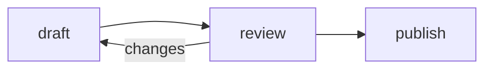

← [Contents](index.md)

## Mermaid diagrams

A `mermaid` fence is drawn as a [Mermaid](https://mermaid.js.org/) diagram:
a flowchart, a sequence, a state machine, a timeline and so on. While you
type, the diagram keeps its last good drawing until the text reads again,
and says under it what's wrong. In a file opened anywhere else, the fence
is still its source.

::: tabs
+++ Source
````markdown

````
+++ Rendered

:::

## Headlines

A `headline` fence is set like a clipping from the paper it ran in: the
paper's name, the headline, and who wrote it and when.

::: tabs
+++ Source
````markdown
```headline
City Library Will Stay Open Until Midnight, "For the Night Owls"

The board says the late hours are a trial through spring.
agency: The New York Times
by: A. Reporter
date: October 3, 2026
url: https://www.nytimes.com/2026/10/03/the-story.html
```
````
+++ Rendered
```headline
City Library Will Stay Open Until Midnight, "For the Night Owls"

The board says the late hours are a trial through spring.
agency: The New York Times
by: A. Reporter
date: October 3, 2026
url: https://www.nytimes.com/2026/10/03/the-story.html
```
:::

- The text is the headline, as you'd write it, quotes, commas and all. A
  second paragraph is the line under it.
- `agency:`, `by:`, `date:` and `url:` lines, anywhere in the fence, say
  the rest; all are optional. The headline links to the `url`.
- The New York Times, The Atlantic, The Guardian, WIRED and Slashdot are
  each set in something like their own type and colors, from fonts your
  machine has (for the Times's nameplate, install
  [Chomsky](https://github.com/ctrlcctrlv/chomsky)). A paper is known by its `agency:` or, without one, by where
  the `url:` points. Any other paper gets a plain clipping.
- Alone on a slide under its title, a headline is centered.

## Numbers

A `number` fence is a figure worth a box of its own: the number, big, and
a line under it saying what it counts.

::: tabs
+++ Source
````markdown
```number
[15%]{seagreen}
daily code change
```
````
+++ Rendered
```number
[15%]{seagreen}
daily code change
```
:::

- The first line is the number; the rest is the line under it, which is
  optional. Both are prose, so `[15%]{seagreen}` colors the number.
- A long number is set smaller, to stay on one line in its box.
- Alone on a slide under its title, a number is centered. For several in a
  row, put them in a `::: columns` block; the boxes come out the same size.

## Images

An image alone in its paragraph is a figure, with a caption: its title if
it has one, otherwise its alt text. Its size goes after its address as
`=WxH`, in pixels, as in the markdown-it-imsize convention. Leave one side
out to keep the image's proportions: `=100x` sets only the width, `=x200`
only the height. A title still goes before it.

::: tabs
+++ Source
```markdown

```
+++ Rendered

:::
